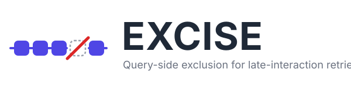

<p align="center">
  <picture>
    <source media="(prefers-color-scheme: dark)" srcset="assets/logo-dark.svg">
    
  </picture>
</p>

<h3 align="center">EXCISE: Query-Side Exclusion for Late-Interaction Retrieval</h3>

<p align="center">
  <a href="https://huggingface.co/datasets/mohammed933/EXCISE-corpora"></a>
  <a href="https://huggingface.co/mohammed933/EXCISE-checkpoints"></a>
  
  
</p>

<p align="center">
  <a href="#overview">Overview</a> ·
  <a href="#the-x-bench-benchmark">Benchmark</a> ·
  <a href="#results">Results</a> ·
  <a href="#installation">Installation</a> ·
  <a href="#quick-start">Quick start</a> ·
  <a href="#training">Training</a> ·
  <a href="#baselines">Baselines</a> ·
  <a href="#data">Data</a> ·
  <a href="#citation">Citation</a>
</p>

**TL;DR.** When a user asks a late-interaction retriever for "X but not Z", the additive MaxSim score rewards the tokens that name Z, so documents about Z are promoted rather than suppressed. **EXCISE** leaves the index frozen: two query-side modules of 1.5M parameters identify the excluded topic and re-embed a 100-document shortlist, and a parameter-free rule demotes the candidates that match it. We also release **X-BENCH**, 1,860 exclusion queries over six collections. On Reason-ModernColBERT, EXCISE raises pooled exclusion success@10 from 0.201 to 0.773.

## Overview

<p align="center">
  
</p>

A detector reads the query. If it finds no exclusion, the frozen ranking is returned unchanged. If it does, EXCISE re-embeds the top 100 candidates, measures how strongly each one covers Z, lowers the score of the strong matches and moves at most three of them to the bottom. The constants are the same on all three backbones and are set in `excise/config.py`.

## The X-BENCH benchmark

Each query asks for a topic X while ruling out one or two topics Z, and comes with a gold document and one excluded document per Z. A query counts as a success@10 only when the gold document is in the top ten and no excluded document is. ExcluIR (554 test queries) and FiQA (208) have training splits; TREC-COVID (343), ESGenius (206), EDGAR (353) and EUR-Lex (196) are zero-shot.

| Tier | The query | Test |
|---|---|--:|
| T1 explicit | states the exclusion with a cue such as *not*, *without* or *excluding* | 693 |
| T2 implicit | has no cue; the exclusion is carried by framing, e.g. *"with the European heavyweight title already covered"* | 569 |
| T3 compound | rules out two topics | 598 |

Training and test data share no query and no document.

## Results

Pooled exclusion success@10 over the 1,860 test queries (Table 1 of the paper). Reason-ModernColBERT indexes 10,000 words per document, GTE-ModernColBERT-v1 and ColBERTv2.0 index 1,000.

| System | Re-index? | Reason-ModernColBERT | GTE-ModernColBERT-v1 | ColBERTv2.0 |
|---|---|---|---|---|
| Frozen ColBERT | no | 0.2011 | 0.1608 | 0.2301 |
| LoRA fine-tune | **yes** | 0.5774 | 0.5823 | 0.5489 |
| Full fine-tune | **yes** | 0.5323 | 0.5263 | 0.5317 |
| Query-only fine-tune | no | 0.5806 | 0.5016 | 0.4608 |
| **EXCISE** | no | 0.7731 | 0.7403 | 0.6995 |

## Installation

```bash
git clone https://github.com/DataScienceUIBK/EXCISE && cd EXCISE
pip install -r requirements.txt
python scripts/download.py --what corpora         # the six collections, 3.2 GB, checked against their sha256  -> data/datasets/
python scripts/download.py --what checkpoints     # the detectors and adapters, 25 MB  -> model/checkpoints/
```

The corpora and checkpoints come from [mohammed933/EXCISE-corpora](https://huggingface.co/datasets/mohammed933/EXCISE-corpora) and [mohammed933/EXCISE-checkpoints](https://huggingface.co/mohammed933/EXCISE-checkpoints). `--tier baselines` and `--tier externals` add the checkpoints of the baselines and of the external systems. The backbones and the BEIR datasets are downloaded into `HF_HOME` on first use.

## Quick start

Every run uses one GPU, with two exceptions: the Reason-ModernColBERT indexes of EUR-Lex and EDGAR do not fit on a single 94 GB GPU. The index is spread over all visible GPUs automatically; EUR-Lex ran with two GPUs visible and EDGAR with four.

```bash
python -m excise.run --list                                                     # backbones, collections, systems
python -m excise.run --backbone reason --dataset excluir --system excise --dry  # print the exact command
for D in excluir fiqa trec-covid esgenius edgar eurlex; do
  python -m excise.run --backbone reason --dataset $D --system excise           # success@10, nDCG@10 and leak, overall and per tier
done
```

The backbones are `reason`, `gte` and `colbertv2`. `excise.run` uses each backbone's document settings from the paper (for ColBERTv2 it sets `EXCISE_DOC_LEN=300`; export that variable yourself when you call `excise.evaluate`, `excise.evaluate_beir` or a trainer directly), and any extra flag (for example `--dump-orders FILE`) is passed to the evaluator. `excise.evaluate_beir` scores ordinary retrieval on SciFact, NFCorpus and ArguAna, and `excise.significance` compares two runs with a paired bootstrap.

## Training

The released checkpoints are the ones the paper reports. To train a detector and an adapter for Reason-ModernColBERT:

```bash
export EXCISE_BACKBONE=lightonai/Reason-ModernColBERT EXCISE_QUERY_LEN=128
python -m excise.train_detector --data data/benchmark/train/detector.jsonl --out model/checkpoints/my_detector --epochs 3 --bs 32 --lr 1e-3 --lora-r 8 --pos-weight 8 --tap proj128 --xz --iob
python -m excise.label_z --triples data/benchmark/train/adapter_triples_unlabelled.jsonl --finder model/checkpoints/my_detector/deepfinder.pt --thr 0.70 --out my_adapter_triples.jsonl
python -m excise.train_adapter --triples my_adapter_triples.jsonl --out model/checkpoints/my_adapter --lr 1e-3 --epochs 3 --lora-r 8 --z-margin 0.10 --z-weight 5.0
```

For ColBERTv2 the detector uses `--lr 5e-4` and the adapter `--z-weight 2.0`; `excise/adopted.json` records every released checkpoint's arguments.

## Baselines

The ColBERT baselines (`frozen`, `loraft`, `fullft`, `qonly`) run through `excise.run --system <name>`. The external retrievers and rerankers (BGE-large, E5-large, GTE-Qwen2, Promptriever, and the BGE and MiniLM rerankers) run through `competitors/`:

```bash
python -m competitors.evaluate_external --model bge-rerank --ft model/checkpoints/bge-rerank --records 'data/benchmark/test/excluir/*.jsonl' --max-doc-words 10000 --window-words 350
python -m competitors.train_external --model bge-rerank --out model/checkpoints/my_bge-rerank   # fine-tune on the same 1,900 retrieval triples
```

The first command scores the released fine-tuned checkpoint (`scripts/download.py --what checkpoints --tier all`); pass the directory given to `--out` as `--ft` to score your own. Each released external checkpoint records its learning rate in `SELECTION.json`; pass it with `--lr` to retrain that model.

## Test-time interventions

`scripts/nine_interventions.py` scores the nine test-time interventions of Appendix A.3, and the plain MaxSim(Z) rule they replace, on the frozen Reason-ModernColBERT index. The excluded topic comes from the record, or from the released detector with `--detector-z`.

```bash
python scripts/nine_interventions.py --source excluir                # oracle Z
python scripts/nine_interventions.py --source fiqa --detector-z      # the detector's Z
```

Two further scripts reproduce the analyses of Appendices A.3 and B.4. `scripts/zcond_shift.py` measures how prepending the excluded topic to a document changes its match to that topic, for the gold and for the excluded document. `scripts/verbatim_overlap.py` splits the test queries by whether the excluded document names the excluded topic verbatim, and reports success@10 for each group from saved per-query outcomes:

```bash
python scripts/zcond_shift.py --sources excluir fiqa
for D in excluir fiqa; do
  python scripts/nine_interventions.py --source $D --detector-z --dump-perquery nine_$D.jsonl
  python -m excise.run --backbone reason --dataset $D --system excise --dump-orders excise_$D.jsonl
done
python scripts/verbatim_overlap.py --sources excluir fiqa --perquery nine_excluir.jsonl nine_fiqa.jsonl \
    --arms maxsimz bm25z --orders EXCISE=excise_excluir.jsonl EXCISE=excise_fiqa.jsonl
```

## Data

| File | Rows | What it is |
|---|--:|---|
| `data/benchmark/test/<collection>/*.jsonl` | 1,860 | the test queries, one file per tier and length |
| `data/benchmark/train/excluir.jsonl`, `fiqa.jsonl` | 1,100 | the training queries |
| `data/benchmark/train/retrieval_triples.jsonl` | 1,900 | the triples every trainable system trains on |
| `data/benchmark/train/adapter_triples.jsonl` | 2,627 | EXCISE's adapter data: the 1,900 triples plus 727 demotion triples, with Z labelled |
| `data/benchmark/train/detector.jsonl` | 12,871 | the detector's queries |

Every test and training record has the same nine fields: `id`, `source` (the collection), `tier`, `length`, `query`, `X` (the wanted topic), `Z` (a list, one entry per excluded topic), `pos_id` (the gold document) and `neg_ids` (one excluded document per entry of `Z`). Documents are linked by id; their text is in the collection's corpus. `data/benchmark/CORPUS_REQUIRED.json` pins each corpus by sha256.

## Repository layout

```
excise/                 the system
  run.py                runs one system on one collection
  exclusion.py          the operator: re-embedding, evidence, soft penalty, hard demotion
  detector.py           the detector
  evaluate.py           evaluation on X-BENCH (evaluate_beir.py: on BEIR)
  train_detector.py     trains the detector (train_adapter.py: the adapter and the ColBERT baselines)
  config.py             paths and constants; the other files are the encoder, MaxSim, metrics and data loading
competitors/            the external systems: training and evaluation
data/benchmark/         X-BENCH
scripts/                download.py, nine_interventions.py, zcond_shift.py, verbatim_overlap.py, slurm_example.sh
```

## Citation

```bibtex
@article{ali2026excise,
  title   = {EXCISE: Query-Side Exclusion for Late-Interaction Retrieval},
  author  = {Ali, Mohammed and Abdallah, Abdelrahman and Jatowt, Adam},
  year    = {2026}
}
```

MIT license for the code and the benchmark records; the corpora remain under their sources' terms.
