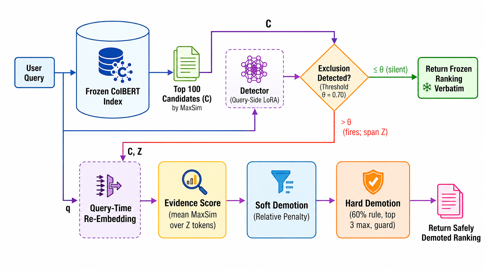

<p align="center">
  <picture>
    <source media="(prefers-color-scheme: dark)" srcset="assets/logo-dark.svg">
    
  </picture>
</p>

<h3 align="center">EXCISE: Query-Side Exclusion for Late-Interaction Retrieval</h3>

<p align="center">
  <a href="https://huggingface.co/datasets/mohammed933/EXCISE-corpora"></a>
  <a href="https://huggingface.co/mohammed933/EXCISE-checkpoints"></a>
  
  
</p>

<p align="center">
  <a href="#overview">Overview</a> ·
  <a href="#the-x-bench-benchmark">Benchmark</a> ·
  <a href="#results">Results</a> ·
  <a href="#installation">Installation</a> ·
  <a href="#quick-start">Quick start</a> ·
  <a href="#training">Training</a> ·
  <a href="#competitors">Competitors</a> ·
  <a href="#data">Data</a> ·
  <a href="#citation">Citation</a>
</p>

**TL;DR.** When a user asks a late-interaction retriever for "X but not Z", the additive MaxSim score rewards the tokens that name Z, so documents about Z are promoted rather than suppressed. **EXCISE** leaves the index frozen: two query-side modules of 1.5M parameters identify the excluded topic and re-embed a 100-document shortlist, and a parameter-free rule demotes the candidates that match it. We also release **X-BENCH**, 1,860 exclusion queries over six collections. On Reason-ModernColBERT, EXCISE raises pooled exclusion success@10 from 0.201 to 0.773.

## Overview

<p align="center">
  
</p>

A detector reads the query. If it finds no exclusion, the frozen ranking is returned unchanged. If it does, EXCISE re-embeds the top 100 candidates, measures how strongly each one covers Z, lowers the score of the strong matches and moves at most three of them to the bottom. The constants are the same on all three backbones and are set in `excise/config.py`.

## The X-BENCH benchmark

Each query asks for a topic X while ruling out one or two topics Z, and comes with a gold document and one excluded document per Z. A query counts as a success@10 only when the gold document is in the top ten and no excluded document is. ExcluIR (554 test queries) and FiQA (208) have training splits; TREC-COVID (343), ESGenius (206), EDGAR (353) and EUR-Lex (196) are zero-shot.

| Tier | The query | Test |
|---|---|--:|
| T1 explicit | states the exclusion with a cue such as *not*, *without* or *excluding* | 693 |
| T2 implicit | has no cue; the exclusion is carried by framing, e.g. *"with the European heavyweight title already covered"* | 569 |
| T3 compound | rules out two topics | 598 |

Train and test share no document, passage, query or pair.

## Results

Pooled exclusion success@10 over the 1,860 test queries (Table 1 of the paper). Reason-ModernColBERT indexes 10,000 words per document, GTE-ModernColBERT-v1 and ColBERTv2.0 index 1,000.

| System | Re-index? | Reason-ModernColBERT | GTE-ModernColBERT-v1 | ColBERTv2.0 |
|---|---|---|---|---|
| Frozen ColBERT | no | 0.2011 | 0.1608 | 0.2323 |
| LoRA fine-tune | **yes** | 0.5564 | 0.0887 | 0.5269 |
| Full fine-tune | **yes** | 0.5027 | 0.1209 | 0.5102 |
| Query-only fine-tune | no | 0.4360 | 0.5484 | 0.5038 |
| **EXCISE** | no | 0.7731 | 0.7403 | 0.6925 |

## Installation

```bash
git clone https://github.com/MohammedAli9330/EXCISE && cd EXCISE
pip install -r requirements.txt
python scripts/download.py --what corpora         # the six collections, 3.2 GB, checked against their sha256  -> data/datasets/
python scripts/download.py --what checkpoints     # the detectors and adapters, 25 MB  -> model/checkpoints/
```

The corpora and checkpoints come from [mohammed933/EXCISE-corpora](https://huggingface.co/datasets/mohammed933/EXCISE-corpora) and [mohammed933/EXCISE-checkpoints](https://huggingface.co/mohammed933/EXCISE-checkpoints); both are private until publication, so run `hf auth login` first. `--tier baselines` and `--tier externals` add the competitors' checkpoints. The backbones and the BEIR datasets are downloaded into `HF_HOME` on first use.

## Quick start

Every run uses one GPU.

```bash
export EXCISE_ROOT=$PWD
python -m excise.run --list                                                     # backbones, collections, systems
python -m excise.run --backbone reason --dataset excluir --system excise --dry  # print the exact command
for D in excluir fiqa trec-covid esgenius edgar eurlex; do
  python -m excise.run --backbone reason --dataset $D --system excise           # success@10, nDCG@10 and leak, overall and per tier
done
```

The backbones are `reason`, `gte` and `colbertv2`. `excise.run` uses each backbone's document settings from the paper, and any extra flag (for example `--dump-orders FILE`) is passed to the evaluator. `excise.evaluate_beir` scores ordinary retrieval on SciFact, NFCorpus and ArguAna, and `excise.significance` compares two runs with a paired bootstrap.

## Training

The released checkpoints are the ones the paper reports. To train a detector and an adapter for Reason-ModernColBERT:

```bash
export EXCISE_BACKBONE=lightonai/Reason-ModernColBERT EXCISE_QUERY_LEN=128
python -m excise.train_detector --data data/benchmark/train/detector.jsonl --out model/checkpoints/my_detector --epochs 3 --bs 32 --lr 1e-3 --lora-r 8 --pos-weight 8 --tap proj128 --xz --iob
python -m excise.label_z --triples data/benchmark/train/adapter_triples_unlabelled.jsonl --finder model/checkpoints/my_detector/deepfinder.pt --thr 0.70 --out my_adapter_triples.jsonl
python -m excise.train_adapter --triples my_adapter_triples.jsonl --out model/checkpoints/my_adapter --lr 1e-3 --epochs 3 --lora-r 8 --z-margin 0.10 --z-weight 5.0
```

For ColBERTv2 the detector uses `--lr 5e-4` and the adapter `--z-weight 2.0`; `excise/adopted.json` records every released checkpoint's arguments.

## Competitors

The ColBERT baselines (`frozen`, `loraft`, `fullft`, `qonly`) run through `excise.run --system <name>`. The external retrievers and rerankers (BGE-large, E5-large, GTE-Qwen2, Promptriever, and the BGE and MiniLM rerankers) run through `competitors/`:

```bash
python -m competitors.evaluate_external --model bge-rerank --ft model/checkpoints/bge-rerank --records 'data/benchmark/test/excluir/*.jsonl' --max-doc-words 10000 --window-words 350
python -m competitors.train_external --model bge-rerank          # fine-tune on the same 1,900 retrieval triples
```

## Data

| File | Rows | What it is |
|---|--:|---|
| `data/benchmark/test/<collection>/*.jsonl` | 1,860 | the test queries, one file per tier and length |
| `data/benchmark/train/excluir.jsonl`, `fiqa.jsonl` | 1,100 | the training queries |
| `data/benchmark/train/retrieval_triples.jsonl` | 1,900 | the triples every trainable system trains on |
| `data/benchmark/train/adapter_triples.jsonl` | 2,627 | EXCISE's adapter data: the 1,900 triples plus 727 demotion triples, with Z labelled |
| `data/benchmark/train/detector.jsonl` | 12,871 | the detector's queries |

A test record holds the query, X, Z, the gold and excluded documents with their texts, and its tier. `data/benchmark/CORPUS_REQUIRED.json` pins each corpus by sha256.

## Repository layout

```
excise/                 the system
  run.py                runs one system on one collection
  exclusion.py          the operator: re-embedding, evidence, soft penalty, hard demotion
  detector.py           the detector
  evaluate.py           evaluation on X-BENCH (evaluate_beir.py: on BEIR)
  train_detector.py     trains the detector (train_adapter.py: the adapter and the ColBERT baselines)
  config.py             paths and constants; the other files are the encoder, MaxSim, metrics and data loading
competitors/            the external systems: training and evaluation
data/benchmark/         X-BENCH
scripts/                download.py, slurm_example.sh
```

## Citation

```bibtex
@article{ali2026excise,
  title   = {EXCISE: Query-Side Exclusion for Late-Interaction Retrieval},
  author  = {Ali, Mohammed and Abdallah, Abdelrahman and Jatowt, Adam},
  year    = {2026}
}
```

MIT license for the code and the benchmark records; the corpora remain under their sources' terms.
